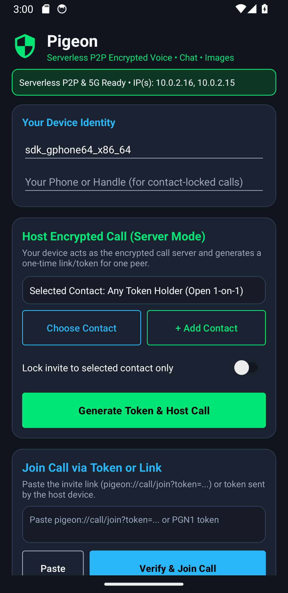
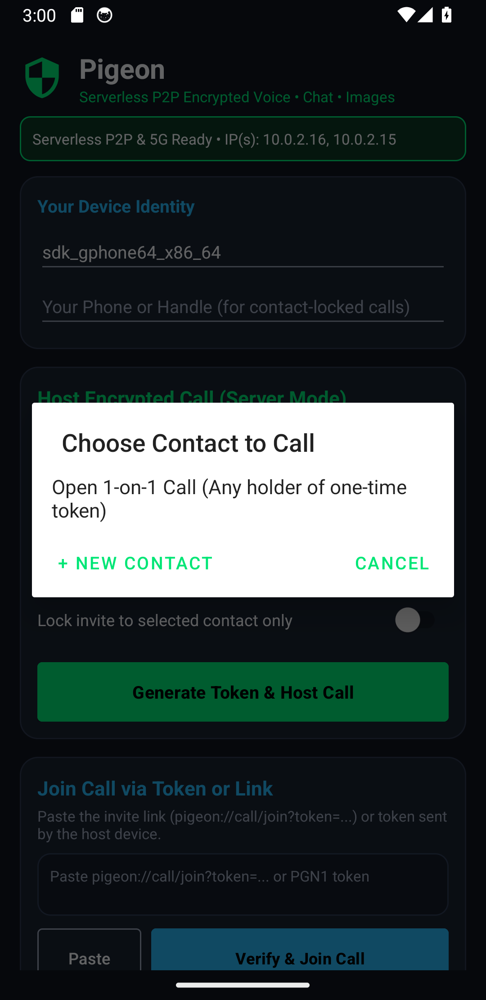
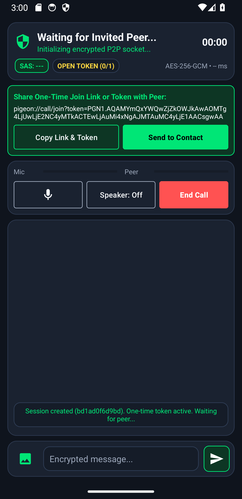
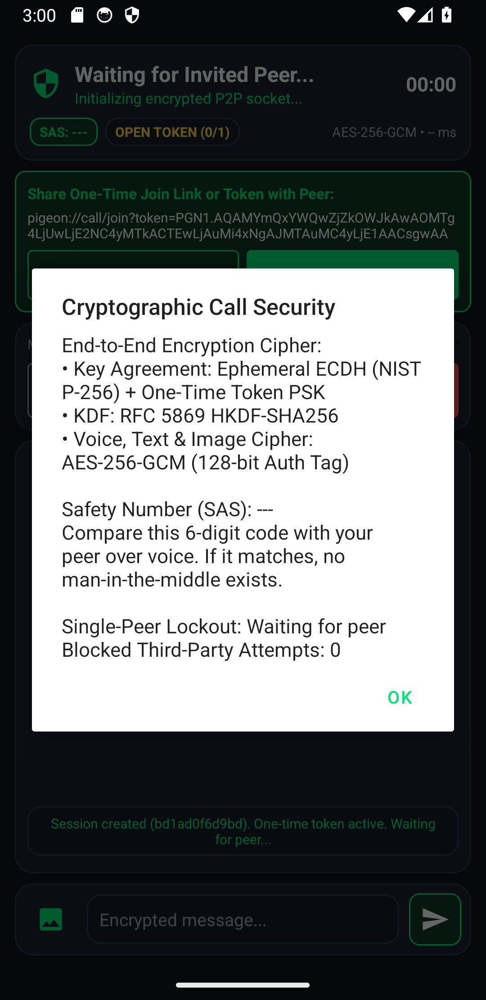
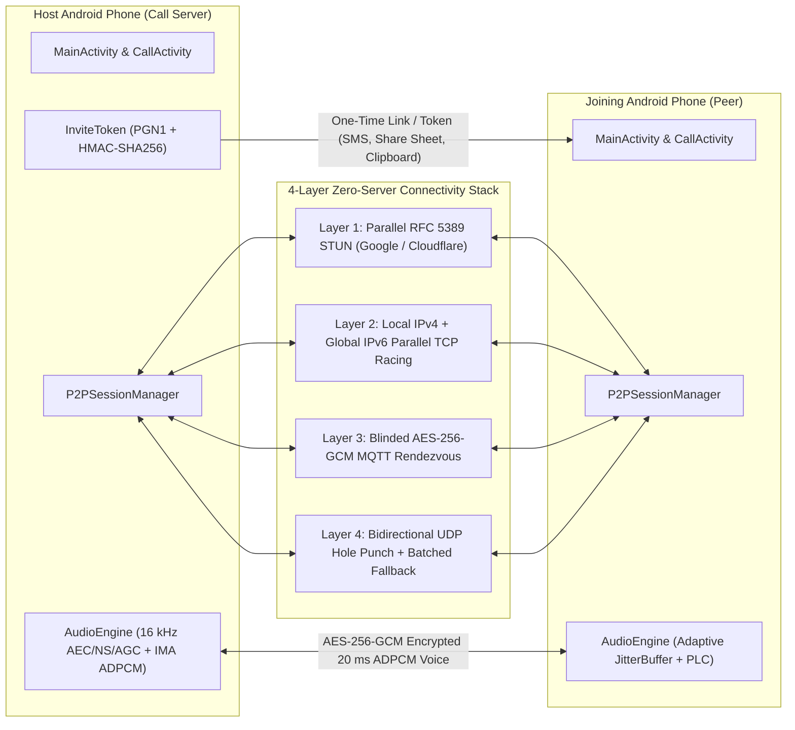

<div align="center">

# Pigeon — Serverless P2P Encrypted Voice Calls, Text Chat & Image Sharing for Android

**Direct peer-to-peer (P2P) encrypted VoIP voice calls, real-time text chat, and image sharing between Android devices over Wi-Fi LAN, 4G/5G mobile networks, and the Internet — with zero custom servers.**

[](https://github.com/daoudz/Pigeon/releases/tag/v0.1)
[-3DDC84?logo=android&logoColor=white)](https://github.com/daoudz/Pigeon/releases/tag/v0.1)
[](#building-from-source--running-tests)
[](#security--end-to-end-encryption)
[](LICENSE)

[**Download APK (v0.1)**](https://github.com/daoudz/Pigeon/releases/tag/v0.1) · [**Screenshots**](#screenshots) · [**How It Works**](#how-it-works-lan--4g5g-internet-architecture) · [**Security Model**](#security--end-to-end-encryption) · [**Build from Source**](#building-from-source--running-tests)

</div>

---

## Overview

**Pigeon** is a native, high-performance **serverless Android voice communication app** built in pure Java (`minSdk 26`, `targetSdk 34`). Instead of relying on a centralized VoIP backend or user accounts, **either Android phone acts as the call host (server)** and generates a cryptographically signed **one-time call link** (`pigeon://call/join?token=...`) or compact token (`PGN1...`) that the invited contact taps or pastes to join an exclusive, end-to-end encrypted 1-on-1 session.

Pigeon works seamlessly both on **local Wi-Fi / hotspot LANs** (direct peer-to-peer sockets) and **across the Internet & 4G/5G Carrier-Grade NAT (CGNAT)** using a 4-layer zero-server traversal stack (RFC 5389 STUN, Global Unicast IPv6, blinded AES-256-GCM rendezvous, and simultaneous UDP hole punching with automatic batched fallback).

---

## Screenshots

| Main Dashboard (Host & Join) | Contact Picker & Lock | Host Call Room & One-Time Link | Cryptographic Call Security |
| :---: | :---: | :---: | :---: |
|  |  |  |  |

---

## Key Features

- **Zero-Server Peer-to-Peer Architecture** — No accounts, no phone number registration, and no backend server to deploy or maintain. Any Android phone can host or join an encrypted call on demand.
- **One-Time Invite Links & Deep Linking** — Share a signed `pigeon://call/join?token=PGN1...` link via SMS, WhatsApp, Signal, or clipboard. Tapping the link opens Pigeon directly and fills the invitation.
- **Exclusive Single-Peer Lockout (No Third Parties)** — Once the invited peer completes the cryptographic handshake, the session atomically locks (`1/1 Peer`). Any third-party attempt to reuse the token is immediately rejected (`FRAME_AUTH_REJECT`) and triggers an on-screen security alert.
- **Contact-Bound Invitations** — Pick a contact from Android Contacts (`ContactsContract`) or saved Pigeon contacts and toggle **"Lock invite to selected contact only"** so only that specific recipient's normalized SHA-256 contact hash is admitted.
- **End-to-End Encrypted Voice, Text & Images** — Ephemeral **NIST P-256 ECDH** + **128-bit one-time token PSK** + **RFC 5869 HKDF-SHA256** deriving directional **AES-256-GCM** keys, plus a 6-digit **Safety Number (SAS)** for out-of-band MITM verification.
- **Clear, Low-Latency Native Android Audio** — 16 kHz wideband speech capture (`VOICE_COMMUNICATION`), hardware **Acoustic Echo Cancellation (AEC)**, **Noise Suppression (NS)**, and **Automatic Gain Control (AGC)**, paired with a zero-allocation **4-bit IMA ADPCM codec** (4x bandwidth reduction: 256 kbps to 65.6 kbps) and an adaptive **Jitter Buffer with Packet Loss Concealment (PLC)**.
- **Works Over Wi-Fi LAN, 4G/5G Cellular & Internet** — Combines direct LAN/VPN/IPv6 sockets with parallel RFC 5389 STUN discovery, simultaneous bidirectional UDP hole punching, mid-call Wi-Fi-to-5G handoff, and automatic out-of-band batched voice fallback under strict Symmetric CGNAT.
- **Encrypted In-Call Text Chat & Image Sharing** — Send real-time UTF-8 messages with encrypted delivery receipts (`✓ E2EE Delivered`) and share memory-safe downsampled JPEG images streamed in 16 KB AES-256-GCM chunks with end-to-end **SHA-256** integrity verification.

---

## How It Works (LAN + 4G/5G Internet Architecture)



1. **Layer 1 — Parallel RFC 5389 STUN (`StunClient`)**: Queries redundant public STUN servers (`stun.l.google.com:19302`, `stun.cloudflare.com:3478`, `stun1.l.google.com:19302`) directly from the call's voice `DatagramSocket` to discover the external NAT-mapped `publicIp:publicUdpPort`.
2. **Layer 2 — Direct LAN & Global Unicast IPv6 (`NetworkUtils`)**: Discovers Wi-Fi LAN, mobile hotspot, USB tethering, mesh VPN (WireGuard/Tailscale), and Global Unicast IPv6 (`2000::/3`, excluding RFC 4193 ULA and link-local addresses) and races direct TCP candidates in parallel for sub-50 ms LAN joins.
3. **Layer 3 — Blinded E2EE Serverless Rendezvous (`ServerlessRendezvousChannel`)**: When NAT or 5G CGNAT blocks unsolicited inbound TCP, both peers connect outbound over TLS to redundant public MQTT v3.1.1 brokers on a one-way HKDF-blinded topic (`pgn/v1/<32-hex>`) with an outer **AES-256-GCM** envelope key derived from `sessionId + inviteSecret`. Brokers never see plaintext metadata, handshakes, messages, or audio.
4. **Layer 4 — Bidirectional UDP Hole Punching & Mid-Call Handoff (`P2PSessionManager`, `CallForegroundService`)**: Both peers exchange all STUN/IPv6/LAN UDP candidates and run 3-way encrypted hole-punch verification (`0x51`) to establish direct P2P UDP voice. On strict Symmetric 4G/5G CGNAT, encrypted voice automatically streams via out-of-band batched datagrams (`160 ms` / up to 8 frames) so text chat and image transfers are never head-of-line blocked. A `ConnectivityManager.NetworkCallback` automatically rebinds UDP and refreshes candidates during mid-call Wi-Fi ↔ 5G switches.

---

## Security & End-to-End Encryption

| Security Layer | Mechanism |
| :--- | :--- |
| **Key Agreement** | Ephemeral **ECDH (NIST P-256 / `secp256r1`)** combined with a 128-bit one-time Invite Token secret (PSK) |
| **Key Derivation** | **RFC 5869 HKDF-SHA256** bound to the full SHA-256 handshake transcript hash (`hostPub`, `clientPub`, `hostNonce`, `clientNonce`) |
| **Cipher & Integrity** | Directional **AES-256-GCM** (128-bit authentication tag) with deterministic 96-bit nonces and AAD binding channel, frame type, and 64-bit sequence number |
| **Anti-Replay** | Strict monotonic sequence verification on TCP/reliable control frames + `O(1)` 64-packet sliding-window bitmap (`CryptoEngine.ReplayWindow`) verified *after* GCM authentication on UDP |
| **MITM Detection** | 6-digit human-verifiable **Safety Number (`SAS: XXX-XXX`)** displayed on both phones |
| **Access Control** | Atomic **1-on-1 Session Lockout** (`isSessionLocked`) + optional **SHA-256 Contact Binding** + active `FRAME_AUTH_REJECT` & intruder alerts |
| **Image Integrity** | 16 KB AES-256-GCM encrypted chunks + full-payload **SHA-256** digest verification before display |

---

## Quick Start

### Option 1: Install Prebuilt APK (v0.1)
1. Download **`Pigeon-v0.1-release.apk`** from the [**GitHub Releases (v0.1)**](https://github.com/daoudz/Pigeon/releases/tag/v0.1) page on both Android phones (Android 8.0 / API 26 or higher).
2. Install the APK and grant Microphone (and optional Contacts / Notifications) permissions.
3. **Start a call in 3 steps**:
   - **Phone A (Host)**: Optionally tap **Choose Contact** -> tap **Generate Token & Host Call** -> tap **Send to Contact** or **Copy Link & Token**.
   - **Phone B (Joiner)**: Tap the received `pigeon://call/join?token=...` link (or tap **Paste** -> **Verify & Join Call**).
   - **Verify**: Confirm the 6-digit **SAS** safety number matches on both screens and start talking, texting, or sharing encrypted photos.

---

## Building from Source & Running Tests

### Prerequisites
- **JDK 17+**
- **Android SDK** (`compileSdk 34`, Build Tools `34.0.0`)

### Build & Verify Locally
```powershell
# Run all 33 Debug & Release unit/integration tests and compile the Debug APK
.\gradlew.bat testDebugUnitTest testReleaseUnitTest assembleDebug

# Build the Release APK
.\gradlew.bat assembleRelease
```

### Automated Test Coverage (33 Tests Across 6 Suites)
- `CryptoEngineTest` — ECDH P-256 + HKDF-SHA256 key derivation, AES-256-GCM tamper rejection, 64-packet anti-replay window, and SAS formatting.
- `InviteTokenTest` — Compact `PGN1` token / `pigeon://` deep link roundtrips, canonical Base64URL HMAC tamper rejection, and contact restriction hashing.
- `AudioCodecAndJitterTest` — IMA ADPCM 4x compression & >0.96 correlation, noise gate/soft limiter, adaptive jitter buffer reordering, PLC, and image downsampling.
- `P2PCallSessionIntegrationTest` — Full loopback encrypted voice/chat/45 KB chunked image roundtrip, multi-intruder single-peer lockout, UDP replay-window poisoning resistance, and graceful hangup delivery.
- `InternetAnd5GConnectivityTest` — Parallel RFC 5389 STUN failover, Global Unicast IPv6 filtering, blinded MQTT rendezvous AEAD & anti-reflection, 5G CGNAT call simulation with UDP hole punching + batched Symmetric CGNAT voice fallback, multi-broker failover, and mid-call Wi-Fi ↔ 5G handoff.
- `UiLayoutAndStringsVerificationTest` — XML layout alignment, compact padding, single-line labels, and icon-only mute button verification.

---

## Project Structure

```text
app/src/main/java/com/pigeon/voice/
├── audio/
│   ├── AdpcmCodec.java                  # Zero-allocation 4-bit IMA ADPCM codec & software DSP
│   ├── AudioEngine.java                 # 16 kHz AudioRecord/AudioTrack + hardware AEC/NS/AGC
│   └── JitterBuffer.java                # Adaptive packet reordering & Packet Loss Concealment
├── contacts/
│   ├── ContactItem.java                 # Canonical phone/handle normalization & SHA-256 hashing
│   └── ContactsRepository.java          # Android ContactsContract + saved Pigeon contacts
├── crypto/
│   └── CryptoEngine.java                # ECDH P-256, HKDF-SHA256, AES-256-GCM, SAS & ReplayWindow
├── net/
│   ├── ActiveSessionRegistry.java       # Process-wide active session coordinator
│   ├── ChatMessage.java                 # Text, image, and security event message model
│   ├── ImageCompressor.java             # Memory-safe two-pass BitmapFactory JPEG downsampler
│   ├── NetworkUtils.java                # Local IPv4 & Global Unicast IPv6 (2000::/3) discovery
│   ├── P2PSessionManager.java           # Serverless P2P host/client engine, lockout & UDP punching
│   ├── ServerlessRendezvousChannel.java # Blinded AES-256-GCM MQTT v3.1.1 rendezvous & fallback
│   └── StunClient.java                  # Parallel RFC 5389 STUN Binding Request client
├── service/
│   └── CallForegroundService.java       # WakeLock, low-latency WifiLock & NetworkCallback handoff
├── token/
│   └── InviteToken.java                 # Signed PGN1 token & pigeon:// deep link codec
└── ui/
    ├── CallActivity.java                # Call room UI: icon mute, meters, SAS dialog, chat & images
    ├── ChatAdapter.java                 # RecyclerView timeline with LruCache bitmap caching
    └── MainActivity.java                # Host/Join dashboard, contact picker & deep link handler
```

---

## License

This project is licensed under the **GNU General Public License v3.0 (GPL-3.0)** — see the [LICENSE](LICENSE) file for full details.
